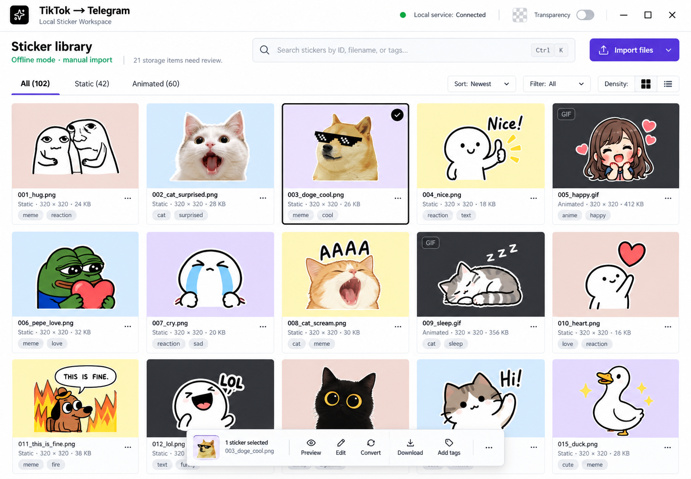
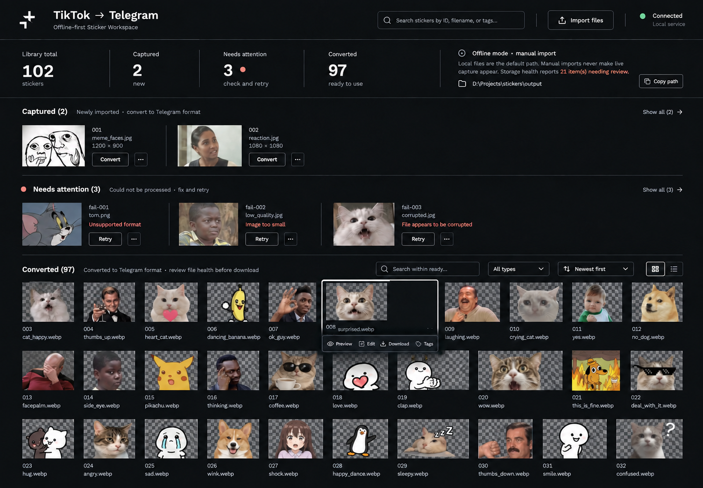

# План редизайна и развития Sticker Powerhouse Suite

Состояние: 25 сентября 2026 года. Пользователь утвердил №7 Specimen Catalogue, группировку стадий №8 и [спецификацию этапа 1](stage1/SPEC.md), затем — её **редакцию 2** (структура под реальные данные и цель «стикерпак для Telegram», см. §2a). Этап 0 зафиксирован в [BASELINE.md](BASELINE.md); структурный этап 2 выполнен и проверен в [STAGE2.md](STAGE2.md). Этап 3 реализован по редакции 2 и принят: [STAGE3.md](STAGE3.md). Этап 4 (задачи и массовые действия) реализован и принят: [STAGE4.md](STAGE4.md). Этап 5 (редактор, Health, архивы) реализован и принят: [STAGE5.md](STAGE5.md). Этап 6 (качество и выпуск) принят: [STAGE6.md](STAGE6.md); ручная приёмка DevTools и решения по данным остаются за пользователем. Этап 7 (паки) в работе.

## 1. Исходная точка

Приложение — локальная React/Vite библиотека стикеров с Node.js API. Основной путь: ручной импорт локальных файлов → проверка и каталогизация → редактирование/нарезка → конвертация → скачивание или ручная загрузка в Telegram. Опциональный live capture через Chrome DevTools отделён от ручного импорта и работает только по явному включению.

На момент проверки JSON-базы: **102 записи, 42 статических, 60 анимированных; 97 `converted`, 3 `failed`, 2 `captured`**. Это снимок данных, а не фиксированные значения для интерфейса. Предыдущий Browser-снимок показывал 21 проблему хранилища; при реализации число следует получать из текущего `/api/status`.

Уже работают: загрузка библиотеки и обновления через WebSocket, поиск по ID/имени/тегам, фильтр по типу, ручной импорт, редактирование тегов, выбор фрагмента анимации, конвертация/повтор, Canvas Editor, скачивание результата и создание archive snapshot. Сервер также содержит `/api/import/har`, но готового пользовательского сценария для HAR нет; его возможность нужно подтвердить ручным тестом на sanitized HAR.

Основная проблема интерфейса: полезная библиотека начинается слишком низко. На повторной проверке этапа 0 при 390×844 первая миниатюра начинается примерно на 1611 px, а страница с текущей порцией карточек достигает около 25 100 px. Клиент сосредоточен в одном большом `frontend/src/App.jsx`; визуальный язык строится на свечении, градиентах и многочисленных вложенных карточках.

## 2. Референсы и два новых направления

MCP Inspo использован как архив композиций реальных сайтов. Его примеры — публичные сайты, поэтому из них берём визуальные принципы, а сценарии и данные — из самого приложения.

| Референс | Что перенести | Что не переносить |
| --- | --- | --- |
| [Emigre](https://0nme3pk5am3urwa9.public.blob.vercel-storage.com/captures/emigre-com/hero.1440.webp?v=1777899723) ([сайт](https://emigre.com)) | Контент сразу занимает экран; продукт сам формирует визуальный ритм | Магазинные элементы и типографику бренда |
| [Lift Type](https://0nme3pk5am3urwa9.public.blob.vercel-storage.com/captures/lift-type-fr--pages-typefaces/hero.1440.webp?v=1789051930) ([сайт](https://www.lift-type.fr/pages/typefaces)) | Крупные цветовые поля для отдельных образцов, короткие подписи, ровная сетка | Кричащую насыщенность как постоянный фон каждого стикера |
| [NB Studio](https://0nme3pk5am3urwa9.public.blob.vercel-storage.com/captures/nbstudio-co-uk/hero.1440.webp?v=1777899229) ([сайт](https://nbstudio.co.uk)) | Чёрное поле, тонкие разделители, лаконичный набор, визуальный материал без лишней рамки | Портфолио и маркетинговый hero вместо рабочих инструментов |

### №7 — Specimen Catalogue

Светлая библиотека, где стикеры — главный визуальный элемент. Над сеткой компактные поиск, тип, сортировка, плотность и импорт; выбор стикера открывает контекстные действия. Разные приглушённые подложки работают как фон для просмотра, но пользователь должен иметь возможность переключиться на прозрачную шахматную сетку. Подходит для поиска, сравнения и ручной каталогизации. В макете рисунки, имена файлов и теги иллюстративные.

### №8 — Production Ledger

Тёмная рабочая доска, группирующая записи по фактическим статусам: `captured`, `failed`, `converted`. Незавершённые задачи видны до контактного листа результатов. Подходит для регулярной обработки небольшого потока новых файлов. Метка `converted` означает статус конвертации, но не гарантирует доступность итогового файла: перед скачиванием учитываем `health` записи. Имена файлов, причины ошибок и миниатюры в макете иллюстративные.

**Утверждённое направление:** №7 — общий визуальный язык с приоритетом стикеров; из №8 берётся группировка по фактическим стадиям. Тёмная палитра №8 не переносится.

### 2a. Редакция 2 (25.09.2026)

Сверка макетов с базой показала, что они опирались на вымышленные данные: все 114 имён файлов — хэши, ручных тегов нет (только системный `import:<имя>`), размер результата записан у 14 из 109 сконвертированных записей, у 84 из 114 исходников большая сторона меньше 512 px. Продукт нужен, чтобы собрать стикерпак для Telegram, поэтому редакция 2:

- делает плитку 1:1 без имени и тегов — стикер опознаётся по картинке, короткому ID и значкам состояния;
- ставит в центр инспектора блок **Telegram check** (формат, измеренный размер к лимиту, длительность, размеры, растягивание исходника) с честным `unknown` для записей, сконвертированных старой версией;
- сокращает навигацию до `Library · Health`: «Обработка» становится фильтром `Needs action` и полосой над сеткой, импорт — кнопкой в шапке с боковой панелью и drop в любом месте окна, Storage и Archives объединены в Health;
- заменяет пастельные подложки по ID переключателем фона превью: нейтральный, шахматка, чат Telegram светлый и тёмный;
- вводит **паки** (упорядоченный набор + эмодзи на стикер + экспорт для @Stickers) как отдельный этап 7 вместо P2 «Collections».

Подробности — в [SPEC.md](stage1/SPEC.md) §0–4.

## 3. Границы продукта

- Offline/manual import остаётся режимом по умолчанию. Его успех никогда не меняет статус DevTools capture на «слушает» или «готов».
- Live capture продолжает читать только уже загруженные браузером bytes через DevTools и отправлять их на loopback. Никаких DOM/UI automation, CDP, CDN refetch или автоматических действий в TikTok.
- Проект только подготавливает Telegram-файлы. Публикация через Telegram остаётся ручной.
- Существующие 102 записи, исходные и сконвертированные media-файлы, IDs, теги, пути и архивы должны сохраниться. UI не получает функцию массового физического удаления.
- Расширение не нуждается в редизайне для первого релиза, но статусы dashboard и popup должны оставаться согласованными по смыслу.
- HAR UI, AI-теги и интеграции с внешними сервисами не входят в основной объём. HAR допускается только после подтверждённого локального capability-теста.

## 4. Карта экранов и сценариев

| Экран/режим | Основная задача | Состояния, которые нужно спроектировать |
| --- | --- | --- |
| Библиотека | Найти, просмотреть и оценить стикеры | Заполнена/пуста; поиск без результатов; loading/error; comfortable/dense; фильтры `Ready` / `Needs action`; полоса Needs action |
| Инспектор стикера | Проверить готовность для Telegram и выполнить действие | Static/animated; Original/Telegram; Telegram check (ok/warning/problem/unknown); отсутствующий original/output; ошибки; теги |
| Панель импорта | Добавить локальные файлы | Drag/drop в окно, лимит, частичный успех, дубликаты, failed, auto-convert |
| Редактор | Подготовить Telegram-версию | Static/animated, transform, text, stroke, trim, before/after, saving/error |
| Health | Понять проблемы хранилища и создать архив | Сводка по категориям, «проверка недоступна», создание архива, пути вывода; список архивов и verify — после API |
| Статус (popover) | Видеть локальный сервис и DevTools режим | Offline, awaiting, last accepted, delivery failed, budget exhausted, disconnected, updates paused |
| Паки (этап 7) | Собрать и экспортировать пак для @Stickers | Черновик, порядок, эмодзи, стикеры без эмодзи или не Ready, экспорт ZIP |

Основной путь первого релиза: открыть библиотеку и сразу увидеть стикеры → сузить поиск или открыть `Needs action` → выбрать стикер → проверить Telegram check → конвертировать/отредактировать → скачать проверенный результат. После этапа 7: собрать пак с эмодзи → экспортировать → загрузить вручную через @Stickers.

## 5. Порядок реализации

### Этап 0. Зафиксировать базу и критерии (1–2 рабочих дня)

1. Снять текущий `git status` и составить список уже существующих незакоммиченных изменений; не сбрасывать и не перезаписывать их.
2. Сделать датированный recovery snapshot базы и media с manifest SHA-256 до изменения модели данных или операций с результатами. Проверить, что snapshot читается; не удалять исходные данные.
3. Выполнить текущий `npm run check`, записать результаты и конкретные известные исключения. Повторить ручной локальный осмотр desktop 1440×900, laptop 1280×800 и mobile 390×844.
4. Зафиксировать fixtures: 102 текущих записи для read-only smoke, отдельный синтетический набор для тестов и каталог из 1000 записей для оценки масштабирования.

**Готово, когда:** есть воспроизводимая стартовая точка, резервная копия и список проверенных сценариев. Это обязательная защита перед рефакторингом dirty tree.

### Этап 1. Утвердить дизайн-спецификацию (2–3 дня)

1. Зафиксировать уже принятое направление: №7 как визуальный язык, стадии №8 в светлом режиме Processing. Не смешивать палитры и геометрию разных концептов.
2. Подготовить точные desktop/mobile макеты для библиотеки, выбранного стикера, редактора, импорта, ошибок и Storage Health. Уточнить реальные текстовые подписи, адаптивную сетку и действия с клавиатуры.
3. Выписать токены: цвет поверхностей/текста/границ, размеры шрифтов и controls, отступы, радиусы, focus, hover, selected, disabled и reduced motion. Подготовить малый набор компонентных правил.
4. Зафиксировать модель навигации: Библиотека, Обработка, Импорт, Хранилище, Архивы; режим DevTools доступен в статусе, не занимает место перед библиотекой.

**Готово, когда:** один согласованный комплект экранов и состояний можно реализовывать без догадок по ImageGen-макету.

### Этап 2. Разделить клиент без изменения поведения (2–4 дня)

1. Выделить из `App.jsx` app shell, подключение session/WebSocket, запросы API, модель библиотеки, import, editor и status.
2. Вынести повторяемые компоненты: toolbar, sticker tile/row, preview, inspector, dialog, toast, status indicator. Оставить server-reported paths и same-origin API.
3. Описать единые selectors для количества, фильтров и групп. Мемоизация только там, где замеры показывают выгоду; главная нагрузка сейчас — длина мобильной страницы, а не подсчёт 102 записей.
4. Сохранить прежние обработчики и API-контракты; проверять поведение после каждого малого переноса.

**Готово, когда:** import/search/tags/convert/editor/archive/WebSocket работают как до переноса, а `App.jsx` больше не владеет всей разметкой и всеми сетевыми эффектами.

### Этап 3. Новая библиотека и responsive UX (4–6 дней) — принят

1. Каркас по редакции 2: шапка `Library · Health`, кнопка состояния с popover (DevTools-состояния, бюджет, пути), кнопка `Import`. Старые баннеры, три счётчика и import-зона над каталогом удаляются; реальные ошибки доставки и хранилища остаются видимыми в popover, Health и полосе Needs action.
2. Сервер: вычисляемое `outputSizeBytes` (`fs.stat` результата) в `GET /api/stickers` и WebSocket-сообщениях, без записи в базу. Селекторы `Ready` / `Needs action` / `Converting`, счётчики по типам и статусам, сортировки `Newest` / `Oldest` / `Largest output` — с unit-тестами. Поиск, фильтры, страница и выбранный стикер синхронизированы с URL.
3. Плитка 1:1 с коротким ID, размером результата и значками состояния; comfortable/dense; фон превью (neutral / transparency / chat light / chat dark) с локальным сохранением; 24 (dense — 48) записи на страницу с `Previous` / `Next`; клавиатурная навигация по сетке.
4. Инспектор с Telegram check, Original/Telegram, действиями по состоянию, ползунком 3-секундного окна для длинной анимации, редактором тегов с сохранением системных `import:` тегов. Desktop ≥ 1100 px — колонка справа; уже — полноэкранный слой с Back.
5. Панель импорта (drop в любом месте окна, `Choose files`, auto-convert, отчёт по каждому файлу из существующего ответа API) и минимальная страница Health (сводка, архив с `<dialog>`-подтверждением вместо `window.confirm`, пути, инструкция @Stickers). Модальный редактор перекрашивается в светлую систему без изменения поведения.
6. Mobile: без нижней навигации; sticky поиск и одна прокручиваемая строка фильтров; 3 колонки при ≥ 360 px. Проверить 320/390/768/1280/1440 px, клавиатуру и 1000-element fixture. Виртуализацию не включать без замеров.

**Готово, когда:** на 1440×900 первый ряд начинается не ниже 200 px, на 390×844 — не ниже 280 px; нет горизонтального скролла; фильтры, URL, страница и выбор сохраняются после WebSocket-обновлений; импорт, теги, convert, download, editor и archive работают как до редизайна.

### Этап 4. Импорт и центр задач (3–5 дней) — принят

1. Отчёт по каждому файлу появляется в панели импорта уже на этапе 3; здесь — доводка текстов причин и сценария «частичный успех», без превращения его в общее сообщение «успех».
2. Пересмотреть последовательный frontend-цикл auto-convert. Добавить серверный batch/job контракт с job ID, безопасной очередью, состоянием queued/running/succeeded/failed и WebSocket `job_update`; существующий per-sticker mutex и лимит concurrency сохранить.
3. Job Center должен отображать только наблюдаемые данные. Процент/ETA показывать, только если backend действительно их измеряет; иначе — статус и количество завершённых задач.
4. Batch tags/convert реализовать с явным отчётом по каждому ID. Для скачивания оставить надёжное действие по одному файлу; пакетный ZIP перенести в следующий этап, чтобы не зависеть от блокировки браузером множества загрузок. После перезагрузки состояние задачи должно восстановиться либо UI должен честно сообщать, что история недоступна.

**Готово, когда:** импорт 30 файлов и частичные ошибки понятны пользователю, массовая конвертация не запускает бесконтрольные запросы и не создаёт гонок для одного ID.

### Этап 5. Редактор, Storage Health и архивы (4–7 дней) — принят

1. В редакторе сделать стабильное превью, Reset/Undo для локальных параметров, сравнение original/result, понятный trim с длительностью и текстом ошибки, единый результат static/animated. Проверить, что preview анимации не обещает точного видео, если показывает только выбранный кадр.
2. Раскрыть Storage Health по типам проблем: missing original, missing converted, orphan, temp, interrupted conversion. Текущий status API отдаёт агрегаты; для списка потребуются отдельный authenticated read-only endpoint и безопасная связь с записями. Никакой автозачистки.
3. Для архивов добавить список и проверку manifest/hash. Создание остаётся через существующий endpoint. Восстановление не включать в первый релиз: сначала отдельный backup-first/dry-run сценарий и интеграционные тесты.
4. Заменить системный `window.confirm` на доступный диалог для создания snapshot; различать обратимые и необратимые операции.

**Готово, когда:** пользователь понимает, что именно сломано, может повторить безопасную операцию и проверить архив без изменения активной библиотеки.

### Этап 6. Качество и выпуск (2–4 дня) — принят

1. Проверить unit-тестами selectors, URL-state, статусы и batch-отчёты. Integration-тестами — новые jobs/health/archive endpoints, авторизацию, лимиты и состояние после restart.
2. Пройти Browser QA для desktop/mobile: import, duplicate, error, search/filter, tags, static/animated preview, trim/edit/convert/download, reconnect, empty/error/health states. Playwright CLI использовать для повторяемых локальных UI-сценариев и регрессии, без автоматизации TikTok.
3. Выполнить `npm run check`, сравнить bundle и время первого полезного отображения с baseline, проверить отсутствие console errors и горизонтального overflow.
4. Прямо сравнить итоговые Browser-скриншоты с утверждёнными макетами. Закрыть отличия по типографике, плотности, отступам, состояниям и адаптиву до релиза.
5. Провести ручную приёмку DevTools capture только на тестовом аккаунте по существующему сценарию; отсутствие дополнительного трафика к TikTok/CDN подтверждается отдельно от UI-тестов.

**Готово, когда:** приняты все сценарии ниже, резервная копия проверена, приложение работает с прежними данными и нет новой capture-автоматизации.

### Этап 7. Паки и экспорт для @Stickers (4–6 дней)

1. Серверное атомарное хранилище паков отдельно от базы стикеров (snapshot перед первой записью): название, упорядоченные ID, эмодзи на стикер. Endpoints с той же session/origin защитой; удаление пака не трогает стикеры и файлы.
2. Панель черновика пака внизу библиотеки, выбор эмодзи в инспекторе, фильтр `Not in a pack`, значок эмодзи на плитке, пункт навигации `Packs` с экраном порядка.
3. Экспорт — локальный ZIP с пронумерованными файлами и шпаргалкой «№ → файл → эмодзи»; блокируется при стикерах без эмодзи или не Ready. Правила форматов и размеров пака сверить с актуальной документацией Telegram перед реализацией.
4. Публикация остаётся ручной через официальный @Stickers; Telegram API не используется.

**Готово, когда:** пак из 20 стикеров собирается, переупорядочивается, переживает перезапуск сервера и экспортируется в ZIP, который можно загрузить в @Stickers без дополнительной подготовки.

Оценка для одного разработчика: **18–31 рабочий день** на этапы 0–6 и ещё **4–6 дней** на этап 7. Диапазон зависит прежде всего от job API, здоровья исторических медиафайлов и объёма состояний редактора. Это оценка трудозатрат, не календарное обещание.

## 6. Контракты и зависимости

| Возможность | Уже есть | Потребуется |
| --- | --- | --- |
| Библиотека/поиск | `GET /api/stickers`, WebSocket `init/new_sticker/sticker_update` | Вычисляемое `outputSizeBytes`; клиентские selectors и URL-state; серверный поиск только при реальном росте данных |
| Импорт | `POST /api/import/files` возвращает `results` | Экран отчёта; согласованный статус auto-convert |
| Конвертация | `POST /api/convert`, серверная очередь с concurrency 2; с этапа 4 — `/api/jobs/*` и WebSocket `job_update` | Постоянная история задач — только по реальной потребности |
| Теги | `POST /api/stickers/:id/tags` | Batch endpoint или ограниченный последовательный клиентский сценарий с частичными ошибками |
| Health | `/api/status` содержит агрегаты, в записи есть `health` | Read-only подробности без опасных «очистить всё» действий |
| Архив | `POST /api/library/archive`, manifest | List/verify endpoint; restore отдельно после backup-first протокола |
| Паки | Отсутствуют | Отдельное атомарное хранилище паков и export ZIP (этап 7) |

Новые endpoint-ы должны применять ту же dashboard session/origin защиту. В WebSocket нельзя отправлять дополнительные данные до авторизации. Данные и пути к файлам не должны утекать в сторонний веб-сервис. При любой миграции JSON сохранять ID и media paths; сперва сделать snapshot, потом обновлять schema с проверкой восстановления.

## 7. Критерии приёмки

- **Сохранность:** все 102 ID baseline присутствуют (к 25.09 библиотека выросла до 114 записей за счёт нового импорта), ни одна запись не пропала; файлы не исчезли из-за редизайна; найденные health-проблемы не удалены автоматически.
- **Поведение:** ручной импорт, дедупликация, теги, trim, статическая/анимированная конвертация, download, archive и WebSocket reconnect работают по прежним правилам. Ошибки показываются без ложного успеха.
- **Capture:** ручной импорт не меняет DevTools status; dashboard не утверждает, что listener открыт, если backend этого не знает. Ни новый frontend, ни backend не выполняют TikTok/CDN refetch или управление страницей.
- **Адаптив:** библиотека и главное действие доступны на 390×844 в первом экране; при 320–1440 px нет горизонтального overflow и недоступных controls.
- **Доступность:** keyboard-only путь от поиска до скачивания, видимый focus, корректные имена controls, модальные окна с управлением фокусом, достаточный контраст и `prefers-reduced-motion`.
- **Производительность:** пользователь видит первые миниатюры быстро на текущей библиотеке; 1000-element fixture не превращает мобильную страницу в десятки тысяч пикселей и не блокирует ввод. Численные бюджеты устанавливаются после baseline замеров на целевом ПК.
- **Соответствие макету:** desktop и mobile проверены в Browser, скриншоты сопоставлены с принятой концепцией. ImageGen-рисунки и фиктивные подписи заменены реальными записями и CSS-компонентами.

## 8. После основного релиза

P2: Favorites и сохранённые виды (паки перенесены в этап 7); поиск похожих дубликатов локальным perceptual hash; локальный поиск по палитре; проверяемый ZIP/manifest экспорт. Эти функции добавлять только после замеров и при наличии понятного пользовательского сценария. HAR-import UI — отдельное решение после локального capability-теста с media response bodies. Внешние AI-сервисы и автоматическая публикация не планируются.

## 9. Ближайшее решение

Этап 3 принят ([STAGE3.md](STAGE3.md)). Этап 4 принят ([STAGE4.md](STAGE4.md)). Этап 5 принят ([STAGE5.md](STAGE5.md)). Этап 6 принят ([STAGE6.md](STAGE6.md)). Для выпуска нужны: ручная приёмка DevTools capture на тестовом аккаунте, решение по трём находкам в данных (Relink для трёх наследных путей, лишние оригиналы, временные папки) и слияние ветки в `master`.
